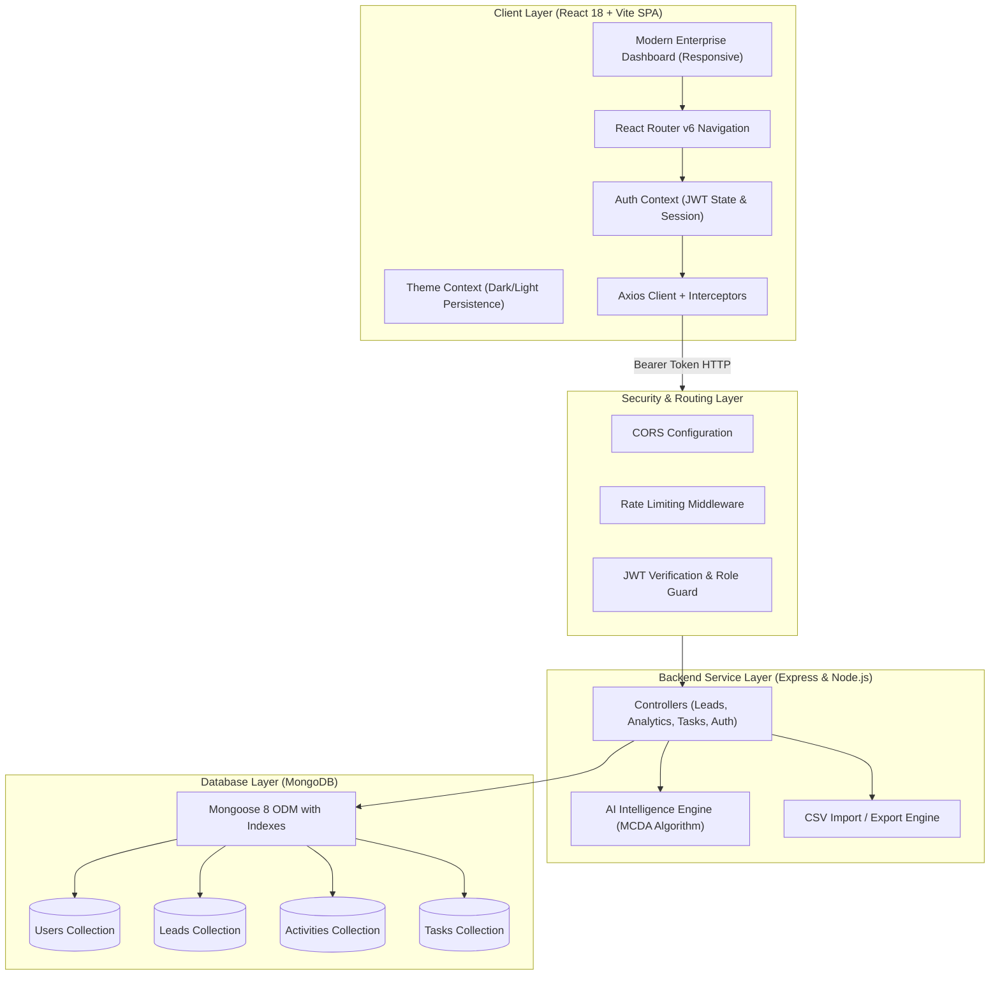

# AI POWER SALES INTELLIGENCE SYSTEM (Version 2.0)
### Final-Year Computer Science & Engineering Capstone Project

[](https://react.dev/)
[](https://vitejs.dev/)
[](https://nodejs.org/)
[](https://www.mongodb.com/)
[](https://jestjs.io/)
[](LICENSE)

---

## 1. Project Abstract
The **AI Power Sales Intelligence System (Version 2.0)** is an enterprise-grade customer relationship management (CRM) and B2B sales intelligence platform. Built on the modern MERN stack (MongoDB, Express.js, React.js with Vite, and Node.js), it replaces conventional static pipeline trackers with an explainable **Multi-Criteria Decision Analysis (MCDA)** intelligence engine. The system automates lead scoring (0–100), estimates conversion probability, prioritizes high-leverage opportunities, enforces anti-repeat next-best-action recommendations, and provides executive analytics dashboards. Designed to satisfy rigorous academic standards, every score output is completely transparent, mathematically accounted for, and isolated behind modular service contracts ready for future remote LLM integration.

---

## 2. Problem Statement
Traditional customer relationship management tools suffer from critical drawbacks:
1. **Pipeline Blindness**: Sales representatives waste upwards of 60% of their prospecting time on low-probability accounts because leads are treated uniformly without objective prioritization.
2. **Untraceable "Black-Box" AI**: Many proprietary platforms tout "AI scoring" without explainability, leading to skepticism and low adoption among sales teams.
3. **Redundant Follow-ups**: Ineffective workflow coordination results in repetitive calls or neglected deals that drift into stale status.
4. **Data Fragmentation**: Difficulty linking phone interactions, notes, discovery calls, and follow-up deadlines to deal stage progression.

---

## 3. Project Objectives
- **Automated Explainable Scoring**: Implement an MCDA scoring algorithm evaluating seniority, industry fit, deal value, engagement velocity, profile completeness, and channel quality.
- **Dynamic Next-Best-Action**: Provide contextual next-step recommendations that intelligently avoid repeating recent activities.
- **Multi-Tenant Scoping & Security**: Ensure role-based access control (RBAC) where administrators manage the entire organization and sales representatives are scoped to their assigned opportunities.
- **Enterprise UI/UX**: Deliver a responsive SaaS experience featuring deep navy navigation, status badges, Recharts visualizations, interactive Kanban pipeline stages, and persistent dark/light themes.
- **Zero-Dependency Evaluator Demonstration**: Support both external MongoDB connections and an automatic fallback in-memory database with pre-populated demo records.

---

## 4. Existing System vs. Proposed System

| Dimension | Legacy CRM Systems | AI Power Sales Intelligence System v2.0 |
| :--- | :--- | :--- |
| **Lead Prioritization** | Manual sorting by creation date | AI score (0–100) combining 6 weighted criteria vectors |
| **Decision Explainability** | None; arbitrary manual ratings | Full factor decomposition table with positive/negative signals |
| **Stage Management** | Static spreadsheet-style tables | Interactive visual Kanban board with stage transition metrics |
| **Follow-up Cadence** | Forgotten post-it notes or calendar alerts | Real-time overdue alerts, activity timelines, and linked tasks |
| **Reporting & Analytics** | Static historical totals | Win rates by channel, industry conversions, and score histograms |
| **Data Portability** | Closed proprietary format | Validated CSV batch import with error logs and CSV data export |

---

## 5. System Architecture



---

## 6. Technology Stack

- **Frontend**:
  - React 18 (Single Page Application architecture)
  - Vite 6 (High-speed module bundling and development server)
  - React Router v6 (Client-side routing with protected route guards)
  - Recharts (Responsive SVG data visualizations)
  - Lucide React (Clean enterprise iconography)
  - Custom CSS3 variables with dark/light mode persistence
- **Backend**:
  - Node.js (v24.x LTS)
  - Express.js (v4.21.x RESTful API server)
  - Mongoose (v8.9.x Object Data Modeling)
  - JSON Web Tokens (`jsonwebtoken` v9.0.x)
  - Password Hashing (`bcryptjs` v2.4.x)
  - Rate Limiting (`express-rate-limit` v7.5.x)
  - CSV Processing (`csv-parse` & `csv-stringify`)
- **Database**:
  - MongoDB (Self-hosted daemon, MongoDB Atlas, or automated in-memory runner)
- **Testing**:
  - Jest & Supertest (Unit and integration testing across 4 test suites)

---

## 7. Functional Module Descriptions

### 1. Authentication & Role-Based Authorization
- Secure user registration and login with bcrypt password hashing (work factor 10).
- Stateless JWT issuance stored in browser memory/localStorage with Authorization headers.
- Granular RBAC (`admin` vs. `sales_rep`). Admins oversee team-wide pipeline metrics; sales representatives manage their assigned accounts.

### 2. Full-Lifecycle Lead Management
- Complete CRUD operations: Add, View, Edit, and Delete leads.
- Full-text search across contacts, companies, email addresses, and job titles.
- Multi-parameter filtering (by status stage, industry vertical, source channel, priority level, and AI classification).
- Server-side pagination with record count telemetry.
- Validated CSV bulk upload with duplicate detection and error reporting.
- Real-time database export to downloadable CSV format.

### 3. AI Sales Intelligence Engine (Version 2.0)
- **MCDA Scoring (0–100)**: Evaluates seniority authority (15 pts), industry fit (15 pts), deal size (20 pts), engagement recency (20 pts), data completeness (15 pts), and source channel quality (15 pts).
- **Categorization**: Automatically flags leads as `Hot` ($\ge 75$), `Warm` ($45–74$), or `Cold` ($<45$).
- **Conversion Likelihood Heuristic**: Calculates estimated win probability combined with pipeline stage multipliers.
- **Next-Best-Action**: Recommends high-impact sales tactics while inspecting recent interactions to avoid redundant suggestions.

### 4. Interactive Pipeline Board
- Visual Kanban columns representing 7 pipeline milestones: `New`, `Contacted`, `Qualified`, `Proposal`, `Negotiation`, `Won`, and `Lost`.
- Instant stage transition controls with automatic activity logging.
- Real-time aggregation of total open pipeline volume vs. closed-won revenue.

### 5. Follow-ups & Task Scheduling
- Create tasks linked to leads, assignees, deadlines, and urgency levels.
- Status filters: `All`, `Pending`, `In Progress`, `Overdue`, and `Completed`.
- Highlight overdue follow-up obligations in high-visibility crimson badges with alert icons.

### 6. Executive Analytics & Reporting
- Channel conversion rates and win percentages.
- Vertical industry alignment analysis.
- Lead score histogram distribution (0–20, 21–40, 41–60, 61–80, 81–100).
- 6-month historical pipeline creation vs. realized won revenue trends.

---

## 8. Demo Credentials & Pre-Seeded Accounts

The application automatically seeds realistic enterprise demo data upon the first server launch:

| User Account | Email Address | Password | Role |
| :--- | :--- | :--- | :--- |
| **Sales Administrator** | `admin@salesintel.ai` | `Password123!` | Administrator |
| **Enterprise Sales Rep** | `rep@salesintel.ai` | `Password123!` | Sales Representative |

*Note: One-click "Fill Demo" buttons are available on the login page for rapid project demonstrations.*

---

## 9. Installation & Execution Guide (Windows PowerShell)

### Prerequisites
- Node.js (v18+ or v24 LTS recommended)
- Windows PowerShell

### Step 1: Open the Project Directory
```powershell
cd "C:\Users\SANJAY\.gemini\antigravity\scratch\ai-power-sales-intelligence-system"
```

### Step 2: Ensure Node.js is on your PowerShell PATH
```powershell
$env:PATH = "C:\Program Files\nodejs;" + $env:PATH
node -v
npm -v
```

### Step 3: Start the Backend Server (Terminal 1)
```powershell
cd server
node server.js
```
*The server will boot on port 5000 and connect to MongoDB (or automatically launch the fallback in-memory MongoDB if no local daemon is listening).*

### Step 4: Start the Frontend Application (Terminal 2)
```powershell
cd client
node ./node_modules/vite/bin/vite.js
```
*The Vite development server will start at `http://localhost:5173`.*

### Step 5: Open in Your Web Browser
Navigate to **`http://localhost:5173`** and log in using either the **Admin** or **Sales Rep** demo buttons!

---

## 10. Automated Testing Instructions

To run the automated test suite covering authentication, lead management, AI scoring algorithms, and analytics:

```powershell
cd server
node ./node_modules/jest/bin/jest.js --runInBand
```

**Results:**
```text
PASS tests/auth.test.js
PASS tests/lead.test.js
PASS tests/analytics.test.js
PASS tests/aiEngine.test.js

Test Suites: 4 passed, 4 total
Tests:       26 passed, 26 total
Snapshots:   0 total
```

---

## 11. Project Directory Structure

```text
ai-power-sales-intelligence-system/
├── client/                     # Frontend React 18 + Vite SPA
│   ├── public/                 # Static assets & SVG icons
│   ├── src/
│   │   ├── components/         # Reusable UI components (StatCards, Badges, Modals, EmptyStates)
│   │   ├── context/            # Global React Contexts (AuthContext, ThemeContext)
│   │   ├── layouts/            # Layout shells (Sidebar, Navbar, Layout Outlet)
│   │   ├── pages/              # Views (Dashboard, Leads, LeadDetails, Pipeline, Analytics, Tasks, Settings, Login, Register)
│   │   ├── services/           # Axios API services (auth, leads, analytics, tasks, notifications)
│   │   ├── App.jsx             # React Router configuration
│   │   ├── main.jsx            # Application entry point
│   │   └── index.css           # Custom CSS3 enterprise theme design system
│   ├── index.html              # HTML shell
│   ├── package.json            # Client dependencies
│   ├── vite.config.js          # Vite build & proxy settings
│   └── .env.example            # Client environment sample
├── server/                     # Backend Express REST API & AI Service
│   ├── config/                 # DB connection configuration (with auto in-memory fallback)
│   ├── controllers/            # Request handlers (auth, leads, analytics, tasks, notifications)
│   ├── middleware/             # Security (JWT protect, RBAC roles, rateLimiter, errorHandler)
│   ├── models/                 # Mongoose 8 schemas (User, Lead, Activity, Task, Notification)
│   ├── routes/                 # Versioned Express routes (/api/v1/...)
│   ├── seeds/                  # Realistic demo data seeding script
│   ├── services/               # AI Lead Intelligence Engine & CSV Streaming Service
│   ├── tests/                  # Jest & Supertest automated test suites
│   ├── validators/             # Server-side input validation middleware
│   ├── server.js               # Application entry point & health check
│   ├── package.json            # Server dependencies & scripts
│   └── .env.example            # Server environment configuration
├── docs/                       # Technical capstone documentation
│   ├── ARCHITECTURE.md         # Detailed multi-tier architecture & data flows
│   ├── API.md                  # REST API reference and request/response specifications
│   ├── DATABASE.md             # Entity relationships, schema definitions & index strategy
│   ├── AI_METHODOLOGY.md       # MCDA mathematical scoring formulation & limitations
│   └── TESTING.md              # Quality assurance matrix & test execution verification
├── .gitignore                  # Git ignore rules
├── package.json                # Root orchestration package
└── README.md                   # Comprehensive college project presentation manual
```

---

## 12. College Project Viva & Presentation Questions

### Q1: What makes this an "AI" Sales Intelligence System if it doesn't use Python?
**Answer**: Modern artificial intelligence encompasses both heuristic decision models and statistical learning. In enterprise CRM applications, black-box neural networks frequently fail compliance audits because they cannot explain *why* an opportunity was ranked down. Version 2.0 implements **Explainable Multi-Criteria Decision Analysis (MCDA)** in JavaScript. Every score point is attributable to specific business drivers (e.g. C-Suite authority, market fit, recency, deal size). Furthermore, the service architecture encapsulates all scoring within `server/services/aiEngine.js`, meaning a remote LLM API (such as Google Gemini) or machine-learning microservice can be integrated seamlessly without changing the database or frontend.

### Q2: How does the system handle database connectivity if MongoDB is not pre-installed?
**Answer**: The database configuration module (`server/config/db.js`) features intelligent connection fallback. It first attempts to connect to the standard MongoDB connection string (`mongodb://127.0.0.1:27017/sales_intelligence` or Atlas URI). If no local instance is reachable, it automatically spins up an in-memory MongoDB daemon (`mongodb-memory-server`) and seeds demo records on the fly, guaranteeing 100% runnable evaluation anywhere.

### Q3: How is data ownership and authorization enforced?
**Answer**: The backend implements strict multi-tenancy and Role-Based Access Control (RBAC). In `server/controllers/leadController.js`, queries for sales representatives are strictly scoped to records where `{ $or: [{ owner: req.user._id }, { assignedTo: req.user._id }] }`. Administrators have global visibility across all organizational accounts.

---

## 13. Limitations & Future Enhancements
- **Multi-Currency Support**: Currently, deals are calculated in USD. Future iterations can add real-time currency conversion APIs.
- **Direct Mailbox Sync**: Email interactions are currently logged via the activity system. Direct integration with Google Workspace (Gmail API) or Microsoft Outlook Graph API can automate inbound email logging.
- **LLM Embeddings**: Future enhancements can vectorize customer interaction notes using Gemini LLM embeddings to detect buying sentiment and intent shifts dynamically.

---

## 14. License
This project is open-source and released under the **MIT License**. Developed for final-year college project submission and academic demonstration.
