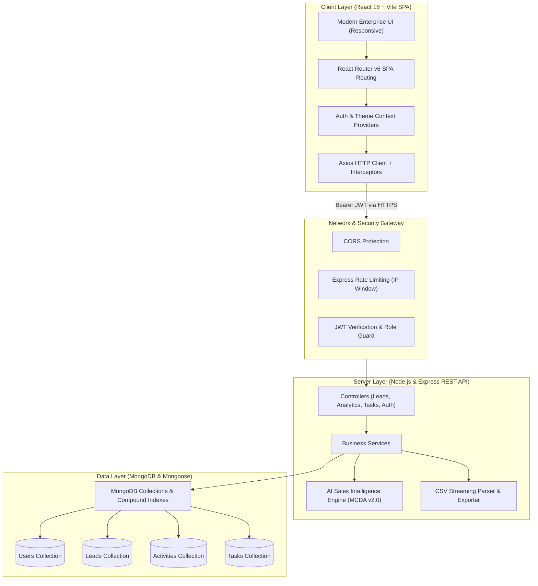

# System Architecture & Technical Specification
## AI Power Sales Intelligence System (Version 2.0)

### 1. Architectural Overview
The **AI Power Sales Intelligence System v2.0** is built as an enterprise-grade multi-tier Single Page Application (SPA) utilizing the MERN stack (MongoDB, Express.js, React.js with Vite, and Node.js). It adheres to a clean separation of concerns, multi-criteria decision analysis (MCDA), role-based access control (RBAC), and stateless JWT-based token security.

---

### 2. Layered Component Architecture

#### A. Client Layer (`client/`)
- **React 18 & Vite 6**: Lightning-fast build tooling and reactive virtual DOM updates.
- **Centralized State & Contexts**:
  - `AuthContext`: Tracks session persistence, user profile, role authorization, and JWT lifecycle.
  - `ThemeContext`: Provides dark and light enterprise theme switches persisted across reloads.
- **Unified API Client**:
  - Axios instance configured with request interceptors to automatically bind `Authorization: Bearer <token>` and response interceptors to handle 401 token invalidations.
- **Data Visualizations**: Recharts integration for responsive rendering of pipeline stage distributions, channel win rates, monthly growth curves, and lead score histograms.

#### B. API Gateway & Security Middleware (`server/middleware/`)
- **JWT Authentication (`auth.js`)**: Validates cryptographically signed JSON Web Tokens from the `Authorization: Bearer` header.
- **Role-Based Access Control (`roles.js`)**: Enforces endpoint permissions between `admin` (global portfolio access) and `sales_rep` (ownership/assignment scoped access).
- **Rate Limiting (`rateLimiter.js`)**: Prevents brute-force credential stuffing on `/api/v1/auth/login` and `/api/v1/auth/register`.
- **Centralized Error Handling (`errorHandler.js`)**: Normalizes Mongoose `ValidationError`, `CastError`, and duplicate index errors into structured RFC-compliant JSON responses.

#### C. Intelligence & Service Layer (`server/services/`)
- **AI Sales Intelligence Engine (`aiEngine.js`)**: Transparent, deterministic Multi-Criteria Decision Analysis (MCDA). It evaluates:
  1. Authority & Seniority (0–15 pts)
  2. Industry Segment Fit (0–15 pts)
  3. Commercial Deal Value (0–20 pts)
  4. Interaction Recency & Velocity (0–20 pts)
  5. Profile Completeness (0–15 pts)
  6. Channel Quality (0–15 pts)
- **Heuristic Conversion Prediction**: Computes transparent buying propensity based on score and pipeline stage.
- **Anti-Repeat Next-Best-Action**: Analyzes the last 3 recorded activities to recommend fresh, high-leverage sales interventions.

#### D. Database & Persistence Layer (`server/models/`)
- **Mongoose 8 ODM**: Schema-enforced models with indexes on high-frequency query fields:
  - `Lead`: Compound index on `{ owner: 1, email: 1 }`, single indexes on `status`, `aiScore`, `dealValue`, and text index on `{ name, company, email }`.
  - `Activity`: Indexed on `{ lead: 1, createdAt: -1 }`.
  - `Task`: Compound index on `{ assignedTo: 1, dueDate: 1, status: 1 }`.
  - `User`: Unique index on `email`.

---

### 3. Authentication & Security Strategy

#### Token Storage & Handling Trade-offs
In this version, tokens are passed via standard HTTP `Authorization: Bearer <token>` headers:
- **Pros**: Completely decouples frontend and backend domains; avoids third-party cookie blocking issues across modern browsers (Safari ITP, Chrome Privacy Sandbox); simplifies cross-origin microservice calls.
- **Mitigations**: Tokens are stored in browser memory/`localStorage` with automated expiration checks; client-side sanitize inputs; CSRF attacks cannot execute because requests require explicit header attachment rather than passive cookie inclusion.
- **Production Recommendation**: For high-compliance banking deployments, tokens can optionally be issued as `HttpOnly`, `SameSite=Strict`, `Secure` cookies with anti-CSRF token headers.

---

### 4. Scalability & Extensibility Roadmap
The backend service architecture uses clean interfaces. If an external large language model (e.g. Gemini 1.5, OpenAI GPT-4o) or custom trained classifier is integrated in the future:
1. Replace or supplement `calculateLeadIntelligence()` in `server/services/aiEngine.js`.
2. Keep the client API interface completely unchanged (`aiScore`, `aiCategory`, `aiFactors`, `conversionLikelihood`, `nextBestAction`).
3. External API keys (e.g., `GEMINI_API_KEY`) remain strictly guarded in the backend environment file and are never exposed to client browsers.
