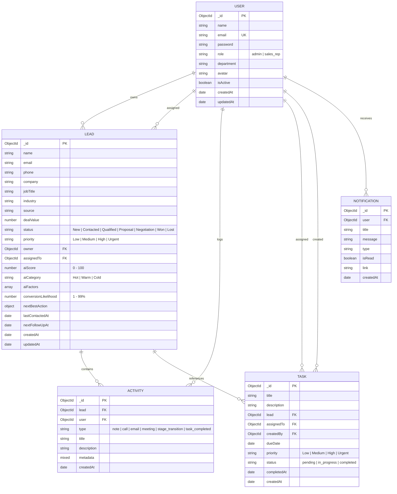

# Database Schema Architecture & Indexing Strategy
## AI Power Sales Intelligence System (Version 2.0)

The system uses **MongoDB** as its persistent document database and **Mongoose 8** as the Object Data Modeling (ODM) layer.

---

### 1. Entity-Relationship Diagram (ERD)

---

### 2. Detailed Collection Schemas

#### A. Users Collection (`User`)
- `name`: String, required, trim, max 100 chars.
- `email`: String, required, unique, lowercase, regex-validated.
- `password`: String, required, minlength 6, excluded from queries by default (`select: false`).
- `role`: String enum (`['admin', 'sales_rep']`), default `'sales_rep'`.
- `department`: String, default `'Enterprise Sales'`.
- `isActive`: Boolean, default `true`.
- **Pre-save Hook**: Automatically hashes `password` with `bcryptjs` using a salt work factor of 10 if modified.
- **Instance Method**: `matchPassword(enteredPassword)` executes asynchronous comparison.
- **JSON Serialization**: Sanitizes output to remove the password hash from returned payloads.

#### B. Leads Collection (`Lead`)
- `name`: Contact person name.
- `email`: Lead contact email.
- `company`: Target enterprise account.
- `jobTitle`: Seniority title (used by AI seniority authority evaluator).
- `industry`: Target market vertical.
- `source`: Acquisition marketing/sales channel.
- `dealValue`: Total commercial proposal size (USD).
- `status`: Lifecycle stage (`New`, `Contacted`, `Qualified`, `Proposal`, `Negotiation`, `Won`, `Lost`).
- `priority`: Urgency level (`Low`, `Medium`, `High`, `Urgent`).
- `aiScore`: Computed integer (0–100).
- `aiCategory`: Classification tier (`Hot`, `Warm`, `Cold`).
- `aiFactors`: Sub-document array storing individual criteria breakdown.
- `conversionLikelihood`: Statistical heuristic percentage.
- `nextBestAction`: Sub-document containing `action`, `reason`, `priority`, and `suggestedDate`.
- `lastContactedAt`: Timestamp of the latest interaction.
- `nextFollowUpAt`: Scheduled follow-up deadline.

#### C. Activities Collection (`Activity`)
- `lead`: Reference to parent `Lead`.
- `user`: Reference to author `User`.
- `type`: Interaction taxonomy (`note`, `call`, `email`, `meeting`, `stage_transition`, `task_completed`).
- `title`: Summary headline.
- `description`: Detailed body notes.
- `metadata`: Freeform JSON for contextual telemetry.

#### D. Tasks Collection (`Task`)
- `title`: Task subject.
- `lead`: Optional reference to linked `Lead`.
- `assignedTo`: Reference to assignee `User`.
- `dueDate`: Deadline timestamp.
- `status`: Completion state (`pending`, `in_progress`, `completed`).

---

### 3. Database Indexes & Query Optimization

| Collection | Index Key | Type | Objective |
| :--- | :--- | :--- | :--- |
| **User** | `{ email: 1 }` | Unique | Enforces single account per email |
| **User** | `{ email: 1, role: 1 }` | Compound | Fast auth lookups & role verification |
| **Lead** | `{ owner: 1, email: 1 }` | Compound | Fast deduplication within owner scope |
| **Lead** | `{ assignedTo: 1 }` | Single | Scoped queries for sales representatives |
| **Lead** | `{ status: 1 }` | Single | Pipeline stage grouping and board queries |
| **Lead** | `{ aiScore: -1 }` | Single | Top opportunity sorting and ranking |
| **Lead** | `{ dealValue: -1 }` | Single | Highest value deals filter |
| **Lead** | `{ name: "text", company: "text", email: "text" }` | Text | Full-text search across lead attributes |
| **Activity**| `{ lead: 1, createdAt: -1 }` | Compound | Rapid chronological timeline rendering |
| **Task** | `{ assignedTo: 1, dueDate: 1, status: 1 }` | Compound | Fast overdue reminder queries |
